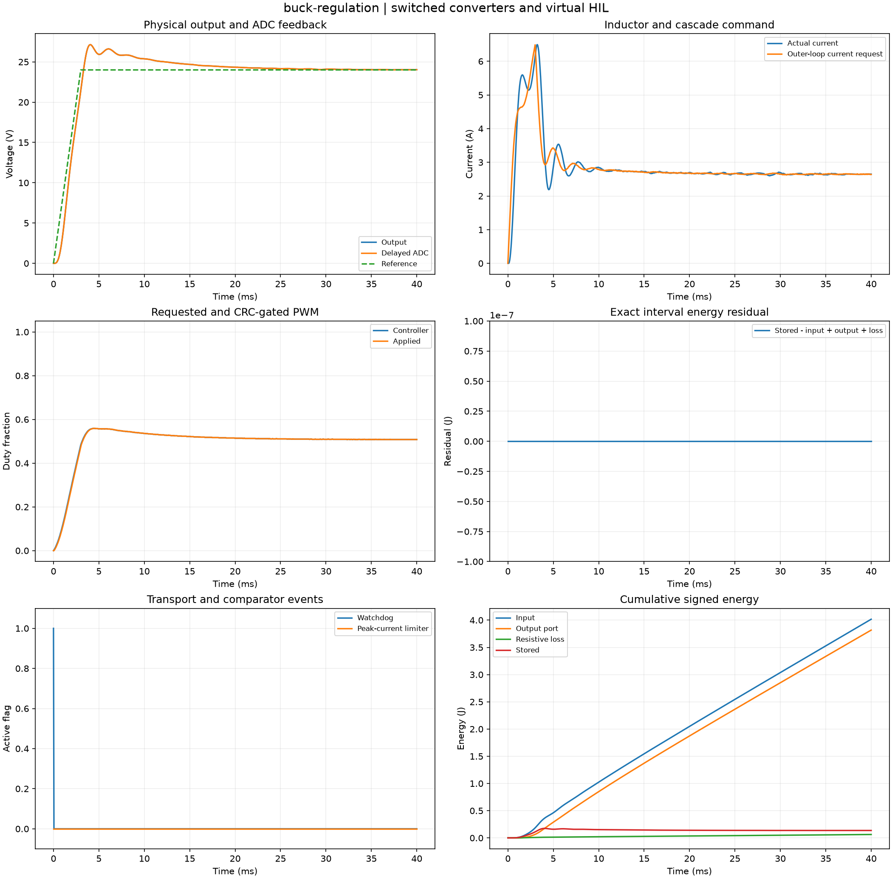
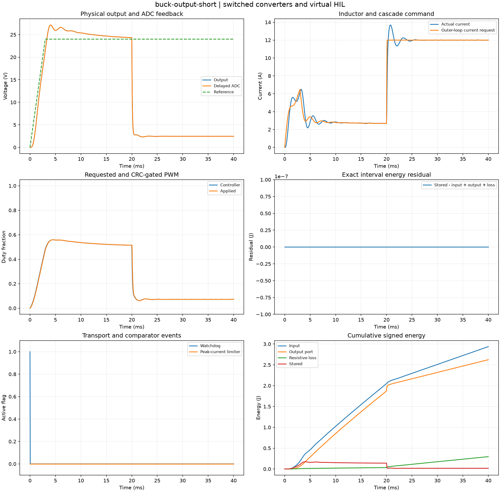
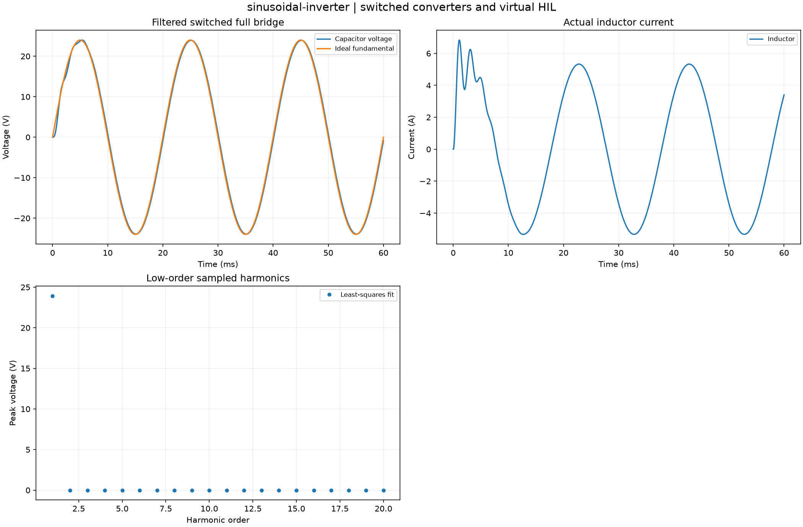
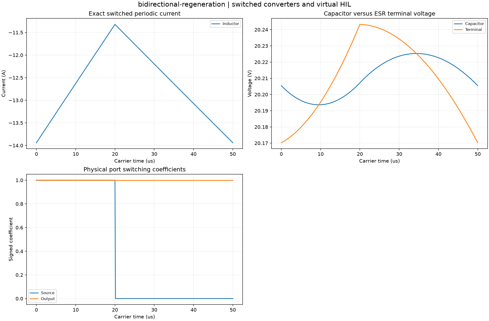
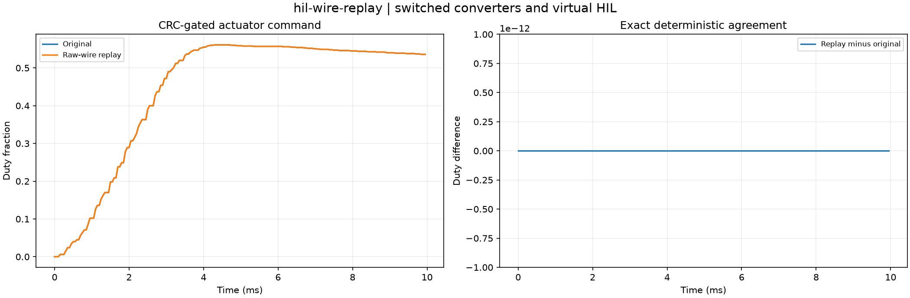

# Computed experiment gallery

Thirty default studies computed from clean source revision [`b037b9bac4fb`](https://github.com/VictorOdoyo/converter-hil-platform/commit/b037b9bac4fb91b47282a5f1fd30d5a00f340256).
All values below come from the sealed captures. Each case directory contains the complete
NPZ arrays, CSV tables, parameters, provenance, plot and HTML report.

HTML files can be opened locally; GitHub previews the figures and tables directly.

| Study | Selected measured outputs | Artifacts |
| --- | --- | --- |
| [buck-regulation](gallery/buck-regulation/figure.png) | accepted_packets = 799; dropped_packets = 0 | [summary](gallery/buck-regulation/summary.csv), [setup](gallery/buck-regulation/parameters.json), [archive](gallery/buck-regulation/fields.npz), [report](gallery/buck-regulation/index.html) |
| [buck-averaged](gallery/buck-averaged/figure.png) | accepted_packets = 799; dropped_packets = 0 | [summary](gallery/buck-averaged/summary.csv), [setup](gallery/buck-averaged/parameters.json), [archive](gallery/buck-averaged/fields.npz), [report](gallery/buck-averaged/index.html) |
| [buck-load-step](gallery/buck-load-step/figure.png) | accepted_packets = 799; dropped_packets = 0 | [summary](gallery/buck-load-step/summary.csv), [setup](gallery/buck-load-step/parameters.json), [archive](gallery/buck-load-step/fields.npz), [report](gallery/buck-load-step/index.html) |
| [buck-input-sag](gallery/buck-input-sag/figure.png) | accepted_packets = 799; dropped_packets = 0 | [summary](gallery/buck-input-sag/summary.csv), [setup](gallery/buck-input-sag/parameters.json), [archive](gallery/buck-input-sag/fields.npz), [report](gallery/buck-input-sag/index.html) |
| [buck-output-short](gallery/buck-output-short/figure.png) | accepted_packets = 799; dropped_packets = 0 | [summary](gallery/buck-output-short/summary.csv), [setup](gallery/buck-output-short/parameters.json), [archive](gallery/buck-output-short/fields.npz), [report](gallery/buck-output-short/index.html) |
| [buck-load-open](gallery/buck-load-open/figure.png) | accepted_packets = 799; dropped_packets = 0 | [summary](gallery/buck-load-open/summary.csv), [setup](gallery/buck-load-open/parameters.json), [archive](gallery/buck-load-open/fields.npz), [report](gallery/buck-load-open/index.html) |
| [low-resolution-adc](gallery/low-resolution-adc/figure.png) | accepted_packets = 799; dropped_packets = 0 | [summary](gallery/low-resolution-adc/summary.csv), [setup](gallery/low-resolution-adc/parameters.json), [archive](gallery/low-resolution-adc/fields.npz), [report](gallery/low-resolution-adc/index.html) |
| [biased-voltage-sensor](gallery/biased-voltage-sensor/figure.png) | accepted_packets = 799; dropped_packets = 0 | [summary](gallery/biased-voltage-sensor/summary.csv), [setup](gallery/biased-voltage-sensor/parameters.json), [archive](gallery/biased-voltage-sensor/fields.npz), [report](gallery/biased-voltage-sensor/index.html) |
| [delayed-measurement](gallery/delayed-measurement/figure.png) | accepted_packets = 799; dropped_packets = 0 | [summary](gallery/delayed-measurement/summary.csv), [setup](gallery/delayed-measurement/parameters.json), [archive](gallery/delayed-measurement/fields.npz), [report](gallery/delayed-measurement/index.html) |
| [hil-packet-loss](gallery/hil-packet-loss/figure.png) | accepted_packets = 533; dropped_packets = 266 | [summary](gallery/hil-packet-loss/summary.csv), [setup](gallery/hil-packet-loss/parameters.json), [archive](gallery/hil-packet-loss/fields.npz), [report](gallery/hil-packet-loss/index.html) |
| [hil-corruption](gallery/hil-corruption/figure.png) | accepted_packets = 533; dropped_packets = 0 | [summary](gallery/hil-corruption/summary.csv), [setup](gallery/hil-corruption/parameters.json), [archive](gallery/hil-corruption/fields.npz), [report](gallery/hil-corruption/index.html) |
| [hil-blackout](gallery/hil-blackout/figure.png) | accepted_packets = 739; dropped_packets = 0 | [summary](gallery/hil-blackout/summary.csv), [setup](gallery/hil-blackout/parameters.json), [archive](gallery/hil-blackout/fields.npz), [report](gallery/hil-blackout/index.html) |
| [hil-stale-commands](gallery/hil-stale-commands/figure.png) | accepted_packets = 0; dropped_packets = 0 | [summary](gallery/hil-stale-commands/summary.csv), [setup](gallery/hil-stale-commands/parameters.json), [archive](gallery/hil-stale-commands/fields.npz), [report](gallery/hil-stale-commands/index.html) |
| [saturation-antiwindup](gallery/saturation-antiwindup/figure.png) | accepted_packets = 799; dropped_packets = 0 | [summary](gallery/saturation-antiwindup/summary.csv), [setup](gallery/saturation-antiwindup/parameters.json), [archive](gallery/saturation-antiwindup/fields.npz), [report](gallery/saturation-antiwindup/index.html) |
| [saturation-unprotected](gallery/saturation-unprotected/figure.png) | accepted_packets = 799; dropped_packets = 0 | [summary](gallery/saturation-unprotected/summary.csv), [setup](gallery/saturation-unprotected/parameters.json), [archive](gallery/saturation-unprotected/fields.npz), [report](gallery/saturation-unprotected/index.html) |
| [ideal-buck-ripple](gallery/ideal-buck-ripple/figure.png) | capacitor_ripple_v = 0.0362895; current_ripple_a = 2.72865 | [summary](gallery/ideal-buck-ripple/summary.csv), [setup](gallery/ideal-buck-ripple/parameters.json), [archive](gallery/ideal-buck-ripple/fields.npz), [report](gallery/ideal-buck-ripple/index.html) |
| [boost-waveform](gallery/boost-waveform/figure.png) | capacitor_ripple_v = 0.277301; current_ripple_a = 4.2844 | [summary](gallery/boost-waveform/summary.csv), [setup](gallery/boost-waveform/parameters.json), [archive](gallery/boost-waveform/fields.npz), [report](gallery/boost-waveform/index.html) |
| [bidirectional-regeneration](gallery/bidirectional-regeneration/figure.png) | capacitor_ripple_v = 0.0316335; current_ripple_a = 2.61919 | [summary](gallery/bidirectional-regeneration/summary.csv), [setup](gallery/bidirectional-regeneration/parameters.json), [archive](gallery/bidirectional-regeneration/fields.npz), [report](gallery/bidirectional-regeneration/index.html) |
| [full-bridge-waveform](gallery/full-bridge-waveform/figure.png) | capacitor_ripple_v = 0.0361079; current_ripple_a = 2.7286 | [summary](gallery/full-bridge-waveform/summary.csv), [setup](gallery/full-bridge-waveform/parameters.json), [archive](gallery/full-bridge-waveform/fields.npz), [report](gallery/full-bridge-waveform/index.html) |
| [diode-discontinuous](gallery/diode-discontinuous/figure.png) | energy_residual_j = 1.22992e-15; max_blocked_fraction = 0.700504 | [summary](gallery/diode-discontinuous/summary.csv), [setup](gallery/diode-discontinuous/parameters.json), [archive](gallery/diode-discontinuous/fields.npz), [report](gallery/diode-discontinuous/index.html) |
| [switched-average-convergence](gallery/switched-average-convergence/figure.png) | coarse_current_error_a = 3.15776; fine_current_error_a = 0.391759 | [summary](gallery/switched-average-convergence/summary.csv), [setup](gallery/switched-average-convergence/parameters.json), [archive](gallery/switched-average-convergence/fields.npz), [report](gallery/switched-average-convergence/index.html) |
| [esr-mode-averaging](gallery/esr-mode-averaging/figure.png) | max_state_difference = 7.18313 | [summary](gallery/esr-mode-averaging/summary.csv), [setup](gallery/esr-mode-averaging/parameters.json), [archive](gallery/esr-mode-averaging/fields.npz), [report](gallery/esr-mode-averaging/index.html) |
| [sinusoidal-inverter](gallery/sinusoidal-inverter/figure.png) | energy_residual_j = -4.83554e-17; fundamental_peak_v = 23.9367 | [summary](gallery/sinusoidal-inverter/summary.csv), [setup](gallery/sinusoidal-inverter/parameters.json), [archive](gallery/sinusoidal-inverter/fields.npz), [report](gallery/sinusoidal-inverter/index.html) |
| [switching-loss-estimate](gallery/switching-loss-estimate/figure.png) | loss_20khz_at_20a_w = 1.40922 | [summary](gallery/switching-loss-estimate/summary.csv), [setup](gallery/switching-loss-estimate/parameters.json), [archive](gallery/switching-loss-estimate/fields.npz), [report](gallery/switching-loss-estimate/index.html) |
| [duty-frequency-response](gallery/duty-frequency-response/figure.png) | boost_rhp_zero_hz = 1562.61 | [summary](gallery/duty-frequency-response/summary.csv), [setup](gallery/duty-frequency-response/parameters.json), [archive](gallery/duty-frequency-response/fields.npz), [report](gallery/duty-frequency-response/index.html) |
| [discrete-lqr](gallery/discrete-lqr/figure.png) | final_voltage_error_v = -2.52948e-63; spectral_radius = 0.696241 | [summary](gallery/discrete-lqr/summary.csv), [setup](gallery/discrete-lqr/parameters.json), [archive](gallery/discrete-lqr/fields.npz), [report](gallery/discrete-lqr/index.html) |
| [voltage-only-observer](gallery/voltage-only-observer/figure.png) | terminal_current_rmse_a = 0.00104254 | [summary](gallery/voltage-only-observer/summary.csv), [setup](gallery/voltage-only-observer/parameters.json), [archive](gallery/voltage-only-observer/fields.npz), [report](gallery/voltage-only-observer/index.html) |
| [deadtime-voltage-error](gallery/deadtime-voltage-error/figure.png) | peak_error_v = 1.92 | [summary](gallery/deadtime-voltage-error/summary.csv), [setup](gallery/deadtime-voltage-error/parameters.json), [archive](gallery/deadtime-voltage-error/fields.npz), [report](gallery/deadtime-voltage-error/index.html) |
| [hil-deadline-overrun](gallery/hil-deadline-overrun/figure.png) | maximum_lateness_us = 240; missed_deadlines = 15 | [summary](gallery/hil-deadline-overrun/summary.csv), [setup](gallery/hil-deadline-overrun/parameters.json), [archive](gallery/hil-deadline-overrun/fields.npz), [report](gallery/hil-deadline-overrun/index.html) |
| [hil-wire-replay](gallery/hil-wire-replay/figure.png) | accepted = 150; maximum_replay_error = 0 | [summary](gallery/hil-wire-replay/summary.csv), [setup](gallery/hil-wire-replay/parameters.json), [archive](gallery/hil-wire-replay/fields.npz), [report](gallery/hil-wire-replay/index.html) |

## Selected fields and diagnostics

### buck-regulation

### buck-output-short

### sinusoidal-inverter

### bidirectional-regeneration

### hil-wire-replay

## Interpretation

Synthetic converter physics and virtual HIL studies. Controllers consume ADC measurements and commands pass a timestamped CRC gate. Switched intervals integrate stored energy and signed port power consistently. Diode blocking and positive-current comparator events are resolved explicitly. Device switching loss and dead-time error are separate declared approximations. Virtual timing is not a hardware real-time guarantee.

Reproduce with `hilconv batch --data-only --output outputs/catalog`, then `hilconv render outputs/catalog` and `hilconv verify outputs/catalog`. Replay retains original source provenance.
